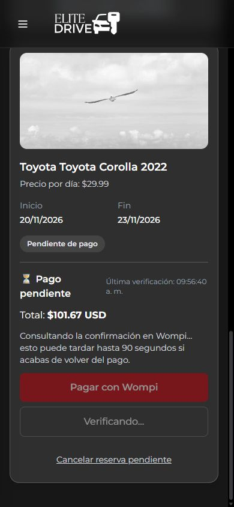
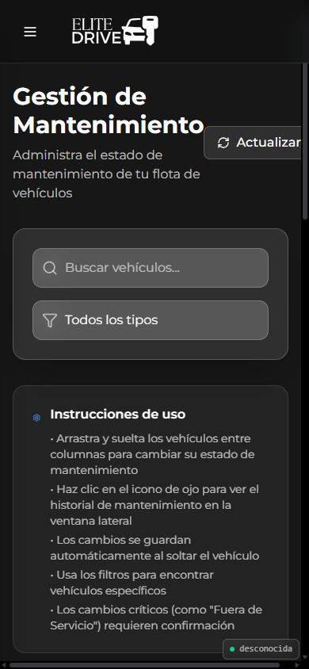
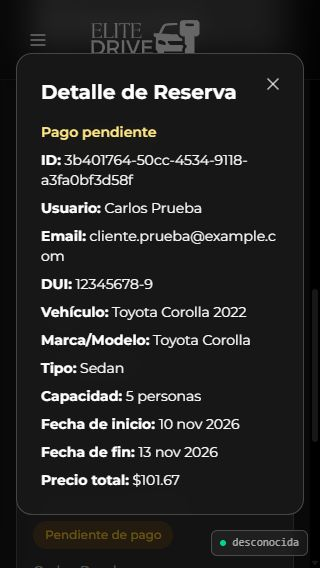

# Auditoría de frontend móvil y flujo de alquiler

> Las capturas de pantalla de esta auditoría ya no están en el repositorio (pesaban
> 1.7 MB). El análisis y los resultados numéricos se conservan aquí y en los `.json`
> de esta carpeta. Las capturas se regeneran con los scripts de `scripts/`.

> Actualización: F01–F05 se corrigieron después de esta auditoría. Ver [correcciones y verificación](CORRECCIONES-F01-F05-2026-10-16.md). El contenido y las evidencias siguientes documentan el estado anterior.

> F06–F24 también tienen correcciones aplicadas. Ver [resultados y límites de la verificación móvil](CORRECCIONES-MOVIL-2026-10-16.md).

Fecha: 16 de octubre de 2026. Entorno: Docker Desktop local, Windows. Zona de referencia: America/Guatemala, UTC−6.

## Resultado

El proyecto está iniciado y los tres servicios funcionan. El flujo de alquiler tiene fallos que conviene corregir antes de considerarlo listo para clientes móviles: disponibilidad incorrecta, doble reserva simultánea, pérdida del vehículo al registrarse y errores de pago que desaparecen.

Esta entrega es una revisión con evidencias y pruebas reproducibles. No se modificó el código funcional de frontend o backend para corregir los hallazgos.

## Proyecto iniciado

| Servicio | Dirección | Estado verificado |
|---|---|---|
| Página web | http://localhost:5173 | HTTP 200; frontend saludable |
| API | http://localhost:18080 | Backend saludable |
| Salud y base de datos | http://localhost:18080/health | `status: UP`, `database: UP` |
| PostgreSQL | Red interna de Compose | Saludable, volumen conservado |

Se creó `.env` local, ignorado por Git, con secretos generados para PostgreSQL y JWT. Se sincronizó la contraseña de conexión del volumen existente y se conservaron sus datos. El puerto 8080 estaba ocupado por el proceso de Windows PID 4; la API usa el 18080. Se conservó el administrador existente; la variable de creación inicial no cambia su cuenta.

Al terminar se verificaron los mismos **3 vehículos y 2 reservas previas**. Las seis reservas creadas durante las pruebas fueron canceladas: una por interfaz, dos por la batería de API, dos por concurrencia y una para comprobar la caché. Se eliminó únicamente la cuenta ficticia creada en esta auditoría, una vez que ya no tenía reservas.

Wompi está desactivado en la configuración local. Se verificaron creación de reserva, error de pago, consulta, reintento y cancelación; no se completó un pago aprobado ni se realizó un cobro.

## Cobertura y límites

Se tomaron **68 muestras de ruta y tamaño**, además de las interacciones de los flujos:

| Grupo | Tamaños de ventana, en píxeles | Pantallas |
|---|---|---|
| Flujo principal | 320×568, 360×800, 375×812, 390×844, 414×896, 430×932, 768×1024, 1024×768, 1440×900 | Inicio, catálogo, reserva, mis reservas |
| Acceso e información | 320×568, 390×844, 844×390 | Login, registro, información, privacidad, términos, cookies, información legal, detalle de sedán |
| Administración | 320×568, 390×844 | Panel, reservas, vehículos, mantenimiento |

Pruebas realizadas en el navegador integrado basado en Chromium, con tamaños de ventana explícitos. Esto comprueba distribución visual y navegación, pero no sustituye una prueba en Safari/iPhone o Chrome/Android reales. No se emularon una red 3G/4G, el teclado virtual, gestos nativos, lector de pantalla o rendimiento de un teléfono físico. Los documentos informativos se revisaron por navegación y distribución, no como dictamen legal. Administración se revisó en lectura, filtros y apertura/cierre de formularios; no se ejecutó su CRUD completo ni se cambiaron vehículos previos.

Las galerías se probaron con los controles de la interfaz. La selección de fechas se verificó mediante los campos nativos accesibles del navegador; la presentación del calendario nativo de iOS/Android queda pendiente de dispositivo real.

## Hallazgos prioritarios

P1: puede impedir el alquiler o comprometer su disponibilidad. P2: genera errores, fricción importante o dificultades de uso móvil. P3: mejora de claridad y accesibilidad. La prioridad es una valoración de esta revisión.

### F01 · P1 · Dos reservas simultáneas para el mismo vehículo

**Reproducción:** enviar cinco solicitudes concurrentes de la cuenta de prueba para el Corolla, del 10 al 13 de abril de 2037. **Resultado: dos HTTP 201 y tres HTTP 400**, con dos reservas del mismo vehículo y rango. Ambas se cancelaron al terminar.

La transacción de creación consulta solapamientos y guarda sin serializar las solicitudes del mismo vehículo. La transacción por sí sola no evita que ambas lean un rango libre antes del primer guardado.

**Cambio recomendado:** bloquear el vehículo al crear la reserva, repetir la consulta de solapamiento dentro de esa transacción y agregar una protección de integridad en PostgreSQL compatible con los estados cancelados. Incorporar una prueba concurrente.

Código: `ReservationService.java:52`, `:64`, `:78`, `:94`; `ReservationRepository.java:26`. Evidencia: [concurrency-results.json](auditoria-movil-2026-10-16/concurrency-results.json).

### F02 · P1 · El catálogo ofrece un vehículo ocupado

**Reproducción:** existe una reserva del Corolla del 10 al 13 de noviembre de 2026. Buscar del 11 al 13 en la interfaz, o del 11 al 12 por API. **Resultado:** figura disponible y habilita “Ver y reservar”; al pulsar pagar, el servidor rechaza la reserva por solapamiento.

La consulta pública usa `findByStartDateBetween`: solo encuentra reservas que empiezan dentro de la búsqueda. Omite las que empiezan antes y continúan dentro del rango.

**Cambio recomendado:** usar la misma condición de solapamiento y estados en disponibilidad y creación. Cubrir rangos interiores, envolventes, parcialmente solapados y contiguos.

Código: `ReservationService.java:104`, `ReservationRepository.java:22`. Evidencias: [API](auditoria-movil-2026-10-16/api-results.json), [catálogo](auditoria-movil-2026-10-16/04-disponibilidad-incorrecta-320.jpg), [intento rechazado](auditoria-movil-2026-10-16/06-conflicto-reserva-320.jpg).

### F03 · P1 · “Reservar” de la portada devuelve al inicio al visitante

**Reproducción:** sin sesión, pulsar “Reservar” en un vehículo de “Disponibles ahora”. **Resultado:** navega a una ruta protegida que redirige a `/`; no abre login ni conserva el vehículo como destino de regreso.

**Cambio recomendado:** compartir el manejo de acceso del catálogo, enviando al login con la ruta de la reserva. La ruta protegida también debe conservar el destino solicitado.

Código: `AvailableVehiclesSection.jsx:86`, `ProtectedRoute.jsx:29`. El botón del catálogo sí llevó al login y regresó correctamente a la reserva al usar una cuenta existente.

### F04 · P1 · “Hoy” deja de ser válido desde las 18:00 locales

**Reproducción controlada:** fecha actual fija `2026-10-17T01:00:00Z`, equivalente al 16 de octubre a las 19:00 en Guatemala. Validar inicio `2026-10-16` y fin `2026-10-17`. **Resultado:** “La fecha de inicio no puede ser anterior a hoy”.

Los campos usan la fecha local como mínimo, pero `validateReservation` calcula hoy con `toISOString()`, que utiliza UTC.

**Cambio recomendado:** tratar las fechas de alquiler como fechas de calendario de la zona del negocio y usar la misma regla en campos, validación y servidor.

Código: `reservationService.js:123`. Evidencia: [date-results.json](auditoria-movil-2026-10-16/date-results.json).

### F05 · P1 · El servidor acepta alquileres en el pasado

**Reproducción:** solicitud autenticada para el Corolla del 10 al 13 de enero de 2001. **Resultado:** HTTP 201, PENDING y total $101.67. La reserva se canceló al terminar.

El servidor valida duración y tarifa, pero no valida que el inicio sea hoy o posterior. Las restricciones visuales del navegador no bastan.

**Cambio recomendado:** validar el inicio en la zona del negocio antes de guardar, con pruebas del cambio de día local.

Código: `ReservationService.java:67`; `CreateReservationDTO.java`. Evidencia: [api-results.json](auditoria-movil-2026-10-16/api-results.json).

## Hallazgos del flujo y del uso móvil

| ID / prioridad | Comportamiento comprobado | Cambio recomendado / ubicación |
|---|---|---|
| F06 · P2 | Tras el HTTP 503 de Wompi en “Mis reservas”, se inicia la consulta del estado PENDING. Esa respuesta borra el error de configuración y deja ambos botones deshabilitados mientras se verifica, con texto de hasta 90 segundos. | Separar el error de crear el enlace del resultado de consultar estado. No iniciar seguimiento repetido si el enlace no pudo crearse. `ReservationPayment.jsx:24`, `:27`, `:54`, `:56`. |
| F07 · P2 | Catálogo → login → crear cuenta → registro exitoso termina en `/customer`, perdiendo el vehículo escogido. Las fechas sobreviven mientras no se recargue. | Propagar el destino por login, registro y acceso automático. `LoginPage.jsx:10`, `RegisterPage.jsx:9`, `RegisterForm.jsx:58`. |
| F08 · P2 | Las fechas elegidas sobreviven a navegación interna e inicio de sesión, pero desaparecen al recargar la página. | Persistir el rango válido en URL o sesión y restaurarlo. `DateContext.jsx:14`. |
| F09 · P2 | Tras pulsar pagar en móvil, el error de solapamiento aparece arriba del formulario y queda fuera de la pantalla. En la muestra de 320 px estaba a `y = −507`, mientras el botón seguía visible. | Mostrar el error junto al botón y llevar foco al mensaje; usar anuncio accesible. Limpiar errores al corregir las fechas. `FacturationDetail.jsx:82`, `:113`, `:126`. |
| F10 · P2 | Cambiar inicio al 20/12 dejando fin 10/12 muestra “disponibilidad del 20/12 al 10/12” y permite “Ver y reservar”. En la siguiente pantalla aparece “Pagar $0.00” deshabilitado, sin explicación junto al rango. | Bloquear todo rango inválido y explicar cómo corregirlo. Al mover inicio, ajustar o limpiar el fin incompatible. `VehiclesPage.jsx:42`, `:102`, `:288`; `DateForm.jsx`. |
| F11 · P2 | A 320×568 el título ELITE queda bajo el encabezado fijo; texto de portada rebasa lateralmente y aparece desplazamiento horizontal interno. | Reservar altura para el encabezado y usar tipografía fluida, ancho mínimo cero y espaciado adaptable a poca altura. `MainHomeSectionMobile.jsx:7`, `:16`. |
| F12 · P2 | El indicador “Fechas / Resumen / Pagando” desborda a 320 px. El contenido de `main` mide 328 px frente a 310 px útiles. | Repartir los pasos sin anchos mínimos incompatibles o apilar etiquetas. `FacturationDetail.jsx:139`. |
| F13 · P2 | En la reserva con fondo claro, el logo y menú blancos se apoyan sobre gris muy claro. Se distinguen mal; el catálogo oscuro no tiene ese problema visual. | Dar al encabezado un fondo opaco adecuado o cambiar su variante según la página. `Header.jsx:8`. No se midió una razón de contraste formal. |
| F14 · P2 | En mantenimiento, “Actualizar” sale de la pantalla en 320 y 390 px. Contenido: 397 px; ancho útil: 310/380 px. “Agregar vehículo” también rebasa el ancho a 320 px. | Apilar título y acciones en teléfono, permitiendo que el bloque de acciones ocupe su propia fila. `MaintenancePage.jsx:125`; `VehicleManagementPage.jsx`. |
| F15 · P2 | Mantenimiento ofrece cambiar estados solo mediante arrastrar y soltar. La tarjeta tiene `draggable` y eventos de drag; el único botón es el historial. | Agregar un selector o menú de cambio de estado que funcione con toque y teclado. `VehicleDragCard.jsx:18`; `StatusColumn.jsx`. Conclusión por controles visibles y código; no se ejecutó un gesto en un teléfono físico. |
| F16 · P2 | Los ocho campos del registro tienen etiquetas con `htmlFor` pero sus inputs no tienen `id`: todos devolvieron cero etiquetas asociadas. | Enlazar cada etiqueta con su campo y conectar errores mediante `aria-describedby` y `aria-invalid`. `RegisterForm.jsx:111` y campos posteriores. |
| F17 · P2 | El menú móvil y el formulario “Agregar vehículo” no se cierran con Escape; el foco permanece en el control que los abrió. El formulario de vehículo tampoco expone `role=dialog`. El detalle de reserva sí tiene diálogo, foco y cierre con Escape. | Reutilizar el patrón accesible del detalle de reserva en menú y formularios; gestionar foco y retorno. `Layout.jsx`, `Sidebar.jsx`, `CreateVehicleForm.jsx`. |
| F18 · P2 | A 1024 px la portada usa el formulario de escritorio de mínimo 700 px junto al título y la barra lateral. `main` tiene 758 px útiles y 1066 px de contenido; parte del formulario queda fuera del área visible. | Basar la disposición en el ancho del contenido o apilar antes. `MainHomeSection.jsx:13`, `DateForm.jsx:27`. |
| F19 · P2 | El paquete inicial de JavaScript es 750.35 kB, 219.75 kB gzip. Se importan por adelantado las páginas administrativas y el calendario incluso para la portada pública. | Cargar rutas bajo demanda y separar calendario/administración. `App.jsx:7`. Es evidencia del build, no una medición de carga en un móvil con red celular. |
| F20 · P3 | Flechas de la galería de reserva: 40×40 y nombres accesibles “‹/›”. Galería administrativa: 36×36, sin nombres descriptivos. | Usar objetivos táctiles de al menos 44×44 y etiquetas de anterior/siguiente. `VehicleImageGallery.jsx`; `components/vehicle/VehicleCard.jsx`. |
| F21 · P3 | El resumen puede estar calculado pero el progreso sigue en “Fechas” al llegar con fechas cargadas. | Derivar el paso del estado efectivo del formulario. `FacturationDetail.jsx:25`, `:139`. |
| F22 · P3 | “Mis reservas” muestra “Toyota Toyota Corolla 2022” y “Honda Honda CRV 2023”. Las tarjetas administrativas redondean $29.99 a $30, aunque reserva y cobro conservan centavos. | Evitar concatenar marca repetida y presentar dinero con dos decimales. `MyReservationsPage.jsx:75`; `components/vehicle/VehicleCard.jsx:86`. |
| F23 · P3 | El documento declara `lang=en` y la aplicación está en español. | Usar `lang=es` o la variante de idioma elegida. `index.html:2`. |
| F24 · P3 | La validación pura lanza “Invalid time value” con una fecha malformada en vez de devolver errores. | Validar el formato y la fecha antes de convertirla. `reservationService.js:123`. Confirmado en prueba de función; el selector nativo normalmente evita esa entrada manual. |

## Duración del alquiler: qué hace hoy

La aplicación solicita **fecha de inicio y fecha de fin**, sin hora de recogida o devolución. La tarifa se calcula por diferencia de fechas; el mismo día equivale a cero días y se rechaza.

Con la tarifa local del Corolla de $29.99 sin IVA:

| Periodo | Días cobrados | Base | IVA 13% | Total |
|---|---:|---:|---:|---:|
| 20 → 21 de noviembre | 1 | $29.99 | $3.90 | $33.89 |
| 20 → 22 de noviembre | 2 | $59.98 | $7.80 | $67.78 |
| 20 → 23 de noviembre | 3 | $89.97 | $11.70 | $101.67 |

El cálculo pasó los casos de cambio de mes, cambio de año, febrero bisiesto y no bisiesto. El total de tres días coincidió entre interfaz y API.

Hay dos decisiones de negocio pendientes que afectan directamente al tiempo alquilado:

1. **Día de devolución:** el cobro de 10 → 13 usa tres días, pero la comprobación de ocupación incluye el día 13 y rechaza otra reserva que empieza ese día. Se comprobó HTTP 400 al intentar 13 → 14 después de crear 10 → 13. Hace falta definir si existe un día de preparación o si debe permitirse la entrega y nueva recogida el mismo día. Si se necesitan horas, deben incorporarse al contrato de datos, disponibilidad y precio, no solo al formulario.
2. **Retención sin pago:** una reserva PENDING bloquea el vehículo aunque falle la creación del enlace. En el código revisado no hay vencimiento de retención ni proceso de liberación automática; se libera mediante cancelación. Definir el plazo y mostrarlo al usuario. La reserva del ensayo siguió pendiente tras el 503 y pudo cancelarse correctamente.

No se implementaron reglas nuevas de horas o facturación en esta auditoría.

## Comportamientos comprobados como correctos

- Login con cuenta existente desde el catálogo: vuelve al vehículo escogido y conserva las fechas durante la navegación interna.
- Registro: bloquea menor de edad y confirmación de contraseña distinta; con datos ficticios válidos crea sesión automáticamente.
- Catálogo: filtros Sedan/SUV/PickUp, galería anterior/siguiente, contador y filtro desde el detalle de sedán.
- Mismo día: deshabilita el botón del catálogo. API: rechaza duración cero, rango invertido, fecha imposible y solapamiento secuencial.
- Reserva: desglose de base, IVA y total; una falla de Wompi no se marca como PAID.
- Mis reservas: lista propia, importe persistido y cancelación de la solicitud de prueba.
- Administración: filtro de pendientes, detalle de reserva legible en 320/390 px y cierre con Escape que devuelve el foco.
- Páginas informativas: navegación accesible sin sesión y sin desbordamiento horizontal global en los tamaños muestreados.
- En teléfonos de 360 a 430 px no se detectó desbordamiento horizontal general en las cuatro pantallas principales. El desplazamiento horizontal de las pestañas del catálogo a 320–375 px es intencional y no se contó como defecto.
- Comprobación de caché: tras crear una reserva, el proxy y la API mostraron inmediatamente la misma ocupación. Ambas respuestas del proxy fueron MISS. **No se reprodujo disponibilidad obsoleta por caché**; el error F02 proviene de la consulta de rangos.

## Resultados de pruebas y rendimiento

| Verificación | Resultado |
|---|---|
| Pruebas existentes del frontend | 30 aprobadas |
| Pruebas existentes del backend | 39 aprobadas |
| Compilación de ambos servicios | Correcta |
| Batería adicional de API | 14 comprobaciones aprobadas; 2 fallidas: solapamiento interior y fechas pasadas |
| Batería adicional de fechas/precios | 9 aprobadas; 2 fallidas: hoy local por la tarde y fecha malformada |
| Concurrencia | Fallida: 2 reservas aceptadas de 5 intentos para el mismo rango |
| Actualización de disponibilidad a través del proxy | Aprobada en el ensayo de caché |
| Revisión estática del frontend | 31 errores y 6 advertencias existentes |

Los errores estáticos incluyen variables sin usar, reglas de hooks y uso de `hasOwnProperty`; no impidieron el build. Las pruebas existentes no cubrían los fallos reproducidos de este flujo.

### Tiempos locales medidos

Tres muestras de cada consulta HTTP, sin limitación de red:

| Consulta | Mínimo–máximo |
|---|---:|
| HTML por 127.0.0.1:5173 | 46–222 ms |
| Catálogo por el proxy, 127.0.0.1:5173 | 114–236 ms |
| Salud de la API, 127.0.0.1:18080 | 31–55 ms |
| Catálogo usando el nombre localhost | 312–350 ms |

En la prueba concurrente, los dos HTTP 201 llegaron en 121 y 128 ms. Son duraciones de solicitudes en esta computadora, no el tiempo completo de interacción de una persona ni una medición de rendimiento en un teléfono. La batería de PowerShell sobre `localhost` registró alrededor de dos segundos por solicitud; se conserva el dato bruto y no se atribuye esa diferencia al servidor sin aislar cliente y resolución de nombre.

Además del tamaño del paquete inicial, hay oportunidades de reducir esperas:

- El registro agrega una espera fija de 1.2 s antes de navegar (`RegisterForm.jsx:57`).
- La consulta repetida de pago usa un presupuesto de 90 s, pero los `fetch` de reserva/pago no tienen cancelación por tiempo. Por inspección del código, una solicitud que no resuelve puede superar ese plazo; no se simuló una conexión colgada.
- Ante error de disponibilidad, el código vacía los vehículos ocupados y anuncia “mostrando todo como disponible”. Conviene mostrar “disponibilidad sin verificar”, evitando presentar una promesa de disponibilidad. Hallazgo por lectura de `VehiclesPage.jsx:303`; no se forzó una caída de servicio durante el ensayo.

## Orden recomendado de corrección

1. Evitar doble reserva concurrente y unificar disponibilidad con la validación de creación.
2. Corregir “Reservar” sin sesión y conservar vehículo/fechas a través de registro, login y recarga.
3. Unificar la zona de calendario y rechazar fechas pasadas desde el servidor.
4. Mantener errores de pago visibles, controlar tiempos de solicitud y definir vencimiento de retenciones PENDING.
5. Resolver portada/pasos de reserva a 320 px, contraste del encabezado y controles táctiles.
6. Completar accesibilidad de campos y diálogos; agregar cambio de mantenimiento mediante toque.
7. Cargar rutas bajo demanda y volver a medir en teléfono real con red móvil.

Para aprobar el recorrido de pago completo faltan credenciales válidas de Wompi en modo de pruebas y un ensayo del proveedor con aprobado, rechazo, abandono y regreso a Mis reservas. La evidencia de tests de pago simulados no equivale a haber recorrido el proveedor real.

## Evidencias y repetición

Carpeta: [auditoria-movil-2026-10-16](auditoria-movil-2026-10-16/).

Resultados sin tokens ni contraseñas:

- [Muestras del navegador](auditoria-movil-2026-10-16/browser-results.json).
- [API](auditoria-movil-2026-10-16/api-results.json).
- [Fechas y precios](auditoria-movil-2026-10-16/date-results.json).
- [Concurrencia](auditoria-movil-2026-10-16/concurrency-results.json).
- [Caché](auditoria-movil-2026-10-16/cache-results.json).
- [Tiempos HTTP](auditoria-movil-2026-10-16/http-timings.json).
- [Resumen de validación](auditoria-movil-2026-10-16/validation-results.json).

Los scripts usan exclusivamente el entorno local. Los de API/concurrencia reciben las credenciales de una cuenta de cliente local existente; la cuenta ficticia de esta auditoría se eliminó. Requieren la flota local de prueba y, para la comprobación del solapamiento interior, la reserva previa del Corolla del 10–13 de noviembre de 2026. Solo cancelan las reservas que crean durante esa ejecución.

```powershell
# Desde la raíz. Usar credenciales de cliente local mediante variables propias.
./scripts/audit-rental-local.ps1 -Email $auditEmail -Password $auditPassword
node ./scripts/audit-rental-concurrency.mjs $auditEmail $auditPassword
$env:TZ = 'America/Guatemala'
node ./scripts/audit-rental-dates.mjs
```

El script de API requiere PowerShell 7 y el de fechas usa únicamente Node.js. El ensayo de concurrencia puede variar entre ejecuciones: una corrida sin duplicados no elimina la carrera que sí se reprodujo.

### Capturas seleccionadas

Portada a 320 px: encabezado sobre el título y texto sin adaptación suficiente.


Reintento de pago: desaparece el error de configuración y aparecen los botones bloqueados verificando.



Mantenimiento a 390 px: la acción Actualizar sale del área visible.



Detalle administrativo a 320 px: ejemplo de diálogo que sí adapta su contenido.


