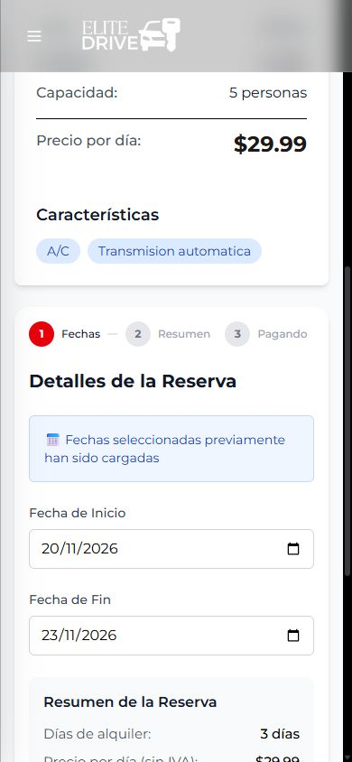
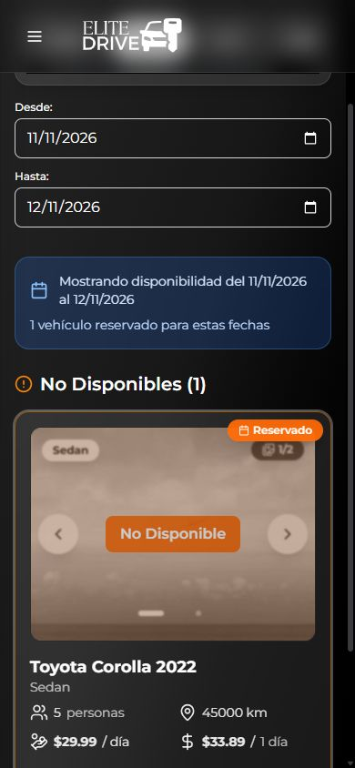

# Correcciones F01–F05: reservas y calendario del negocio

Implementadas y verificadas el 16 de octubre de 2026 en Docker Desktop local.

## Cambios

| Hallazgo | Corrección | Verificación |
|---|---|---|
| F01 · Reservas simultáneas | Se bloquea la fila del vehículo antes de consultar solapamientos y se conserva el bloqueo hasta terminar la transacción. PostgreSQL agrega una restricción de exclusión por vehículo y fechas para proteger también escrituras que no pasan por el servicio. | Cinco rondas de cinco solicitudes concurrentes: **una aceptada y cuatro rechazadas en cada ronda**. |
| F02 · Disponibilidad incorrecta | Disponibilidad pública, consulta de rangos y creación usan la misma condición de solapamiento y los mismos estados que retienen inventario. | Rangos interiores, envolventes, parciales, exactos y en los extremos; rangos libres antes y después. El caso original del Corolla ahora aparece ocupado en la interfaz. |
| F03 · Reservar sin sesión | La portada y el catálogo comparten la navegación de reserva. Los visitantes van al login con el vehículo de destino. La ruta protegida conserva también los parámetros y el fragmento del enlace. | Portada → login → Corolla, con 20–23 de noviembre, tres días y $101.67 conservados durante la navegación. Enlace directo → login → destino original completo. |
| F04 · Hoy después de las 18:00 | Campos y validación usan fechas de calendario de `America/El_Salvador`. El servidor usa un `Clock` con esa misma zona, independiente de la zona del sistema operativo. | Pruebas con UTC ya en el día siguiente, hasta las 23:59:59 locales, y exactamente al cambiar el día local. |
| F05 · Alquileres pasados | El servidor rechaza inicio anterior al día actual del negocio antes de bloquear el vehículo o guardar la reserva. | El alquiler del 10–13 de enero de 2001 devuelve HTTP 400. Un alquiler que empieza hoy se acepta y luego se cancela en la prueba. |

Se conserva el cálculo por diferencia de fechas, IVA del 13% y la ocupación inclusiva del día de devolución. No se introdujeron horas de entrega/devolución ni cambios de diseño. Los demás hallazgos del frontend, incluido el regreso desde registro y la persistencia al recargar, continúan pendientes de la siguiente etapa.

La validación compartida también rechaza fechas malformadas sin lanzar excepciones ni generar importes `NaN`.

## Protección en PostgreSQL

`src/main/resources/db/reservation-integrity.sql`, dentro del backend, instala:

```sql
EXCLUDE USING gist (
    car_id WITH =,
    daterange(start_date::date, end_date::date, '[]') WITH &&
) WHERE (payment_status IS DISTINCT FROM 'CANCELLED')
```

PENDING, PAID, PAID_TEST y el estado heredado NULL retienen las fechas. CANCELLED queda excluido. Reactivar una reserva cancelada que solapa otra también es rechazado por la base.

`ReservationIntegrityInitializer` aplica el cambio transaccionalmente después de inicializar JPA. El script es idempotente y utiliza un bloqueo de migración para coordinar varios arranques. Se comprobó su segunda ejecución sobre el mismo esquema. Requiere PostgreSQL con la extensión `btree_gist`; en la configuración local se instaló automáticamente.

PostgreSQL valida los registros existentes al agregar la restricción. Si otro entorno contiene reservas solapadas, la instalación falla y esas reservas deben revisarse antes de arrancar la nueva versión; el script no elimina ni cancela registros automáticamente. Los errores de conflicto de integridad se devuelven como HTTP 400 con un mensaje de reserva ocupada, sin detalles SQL.

Antes de aplicar el cambio se creó una copia local de PostgreSQL en el directorio temporal del equipo. La instalación conservó la flota y las reservas anteriores.

## Pruebas ejecutadas

| Verificación | Resultado |
|---|---|
| Suite de frontend, incluidas nuevas regresiones | **37/37** |
| Suite de backend, incluidas nuevas regresiones | **50/50** |
| Integración HTTP contra Docker/PostgreSQL | **29/29** |
| Reproducción original de fechas y precios | **11/11** |
| Restricción de base, mediante inserciones directas | **6 conflictos rechazados; cancelada y periodo libre aceptados** |
| Reaplicación de la migración | Correcta, sin duplicar la restricción |
| Navegador | Login desde portada, retorno con fechas, enlace directo y disponibilidad interior correctos |
| Compilación de las imágenes | Correcta |
| Estado final | PostgreSQL, backend y frontend saludables |

Las pruebas de base se ejecutan dentro de una transacción que termina en ROLLBACK. Las reservas creadas por la batería HTTP se cancelaron; se verificó `uncleanedReservations: 0`. La base conserva **3 vehículos y las 2 reservas originales**.

## Evidencias

- [Resultados HTTP: 29 comprobaciones](VERIFICACION-F01-F05-2026-10-16.json).
- [Resultados de fechas: 11 comprobaciones](VERIFICACION-FECHAS-2026-10-16.json).
- [Comprobación del navegador](verificacion-f01-f05-2026-10-16/browser-results.json).
- [Comprobación de integridad e idempotencia](verificacion-f01-f05-2026-10-16/database-results.json).





## Repetir las regresiones

Desde la raíz del repositorio, con el proyecto local iniciado y credenciales de un cliente de prueba en las variables indicadas:

```powershell
docker compose up -d --build
node scripts/test-rental-business.mjs $auditEmail $auditPassword
node scripts/audit-rental-dates.mjs
Get-Content scripts/test-reservation-integrity.sql -Raw |
  docker compose exec -T postgres psql -v ON_ERROR_STOP=1 -U elitedriver -d elitedriver
```

Los scripts de integración están dirigidos a la flota de prueba local: esperan un Toyota Corolla 2022 con tarifa $29.99. El script SQL utiliza el cliente local `cliente.prueba@example.com`. No se deben ejecutar contra datos de producción. Los resultados de la auditoría original se conservan como evidencia del estado anterior.

Las suites se ejecutan durante la construcción de Docker. El frontend también puede verificarse mediante `npm test` en `apps/EliteDriverFrontEndSoft`.
